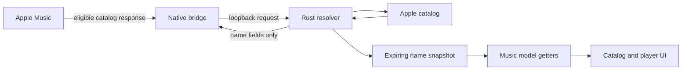

# Architecture

## Runtime

The AppKit menu lives on the main thread. A Tokio runtime handles a loopback server,
Apple catalog requests, cache publication, and lifecycle actions. A short-lived system
LLDB process compiles the Objective-C++ bridge into Music's arm64e process and detaches.
No Python daemon or browser is part of normal operation.

`native/LiveNamesHook.mm` covers selected Apple HTTPS catalog/recommendation routes.
`native/ModelNamesHook.mm` covers name getters for store metadata and Music models.
The bridge is deliberately written using runtime calls to avoid linking private framework
headers. arm64e pointer authentication and block ABI handling are essential; ordinary
arm64 compilation does not establish runtime correctness.

## Matching

`src/resolver.rs` collects typed resource IDs and asks `src/catalog.rs` for source and
equivalent catalog resources. Artist biographies, explicit regional genres, and unambiguous
solo-credited releases can indicate a catalog region. Collaborations and conflicting
origin evidence must not turn into a country guess.

Songs require the equivalent mapping plus exact catalog milliseconds, content rating, and
available artist identity checks. Albums also check release date, track count, and sampled
track-to-album relationships. Name-only references without `attributes` remain references.

Only `name`, `artistName`, `albumName`, and `albumArtistName` are rewritten. No approximate
matching by title or duration alone is used. Native getters look up names by their existing
store ID in an expiring snapshot of already-validated results.

A Music playback model can truncate catalog milliseconds to whole seconds or expose a
slightly different decoded asset duration. `native/DurationPolicy.h` permits the exact
whole-second floor or a fractional offset of up to 100 ms **only for MPModelSong**.
Store metadata and cross-catalog recording checks retain exact millisecond matching.

## Bounds and failure behavior

- Two Tokio runtime threads; at most two simultaneous transforms and six outbound HTTP requests.
- At most 16 loopback connections; 8 MiB per input message and 12 MiB per decoded catalog response.
- Metadata cache bounded to roughly 8 MiB serialized / 3,000 entries; name cache to 10,000 entries.
- A transform has a six-second deadline; the bridge's socket I/O timeout is seven seconds.
- Names are published atomically every five seconds with a short expiry. Generation guards
  prevent delayed transforms from republishing after pause or cache clearing.
- On timeout, invalid input, ambiguity, or missing catalog evidence, the original data is kept.
- Normal shutdown restores method implementations. A crash cannot run shutdown, so expiring
  snapshots and original-response fallbacks remain necessary; restart Music if needed.

The local wire format is an eight-byte little-endian unsigned length followed by JSON bytes.
A zero-length reply means “keep the original.” The service is loopback-only and unauthenticated.
A malicious local process is outside its trust model; never forward the port.

## Source map

| Path | Responsibility |
| --- | --- |
| `src/main.rs` | Lifecycle, bounded service, preferences, persistence, logs |
| `src/platform.rs` | AppKit UI, process discovery, login startup, About |
| `src/indicator.rs` | Semantic status-to-symbol/color mapping |
| `src/platform/menu_test.rs` | Optional development-only native menu driver |
| `src/catalog.rs` | Public catalog client, batching, credentials, metadata cache |
| `src/resolver.rs` | Identity matching and name-only transformation |
| `src/bridge.rs` | Bounded LLDB installation/control and detachment |
| `native/` | Objective-C++ bridge and playback duration policy |
| `tests/` | Native duration regression and arm64e syntax harnesses |

## Known limits

The catalog integration and Music runtime interfaces are unsupported by Apple and may change.
A successful build on a GitHub runner does not verify its Music version. Precomposed headings,
lyric credits, playlists, and other unhooked surfaces may retain their original localized text.
CI does not disable SIP, sign in to Apple Music, install hooks, or play media.
